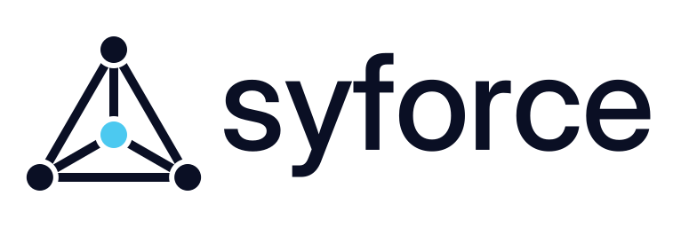
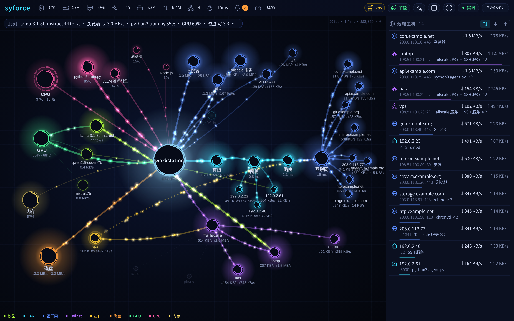
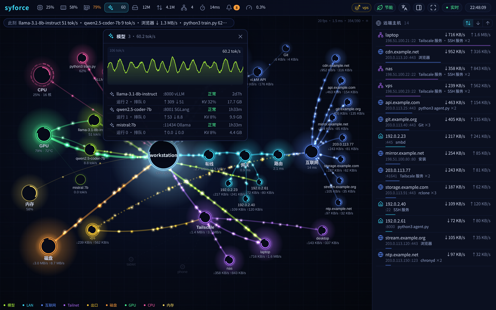
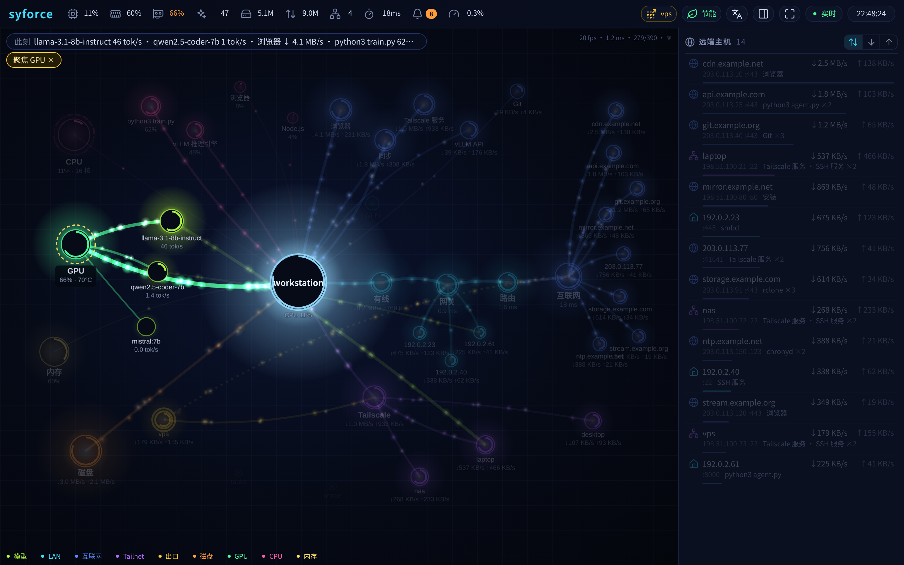
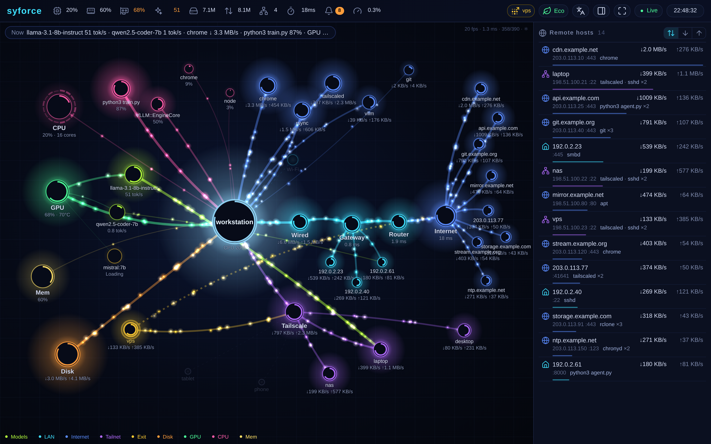
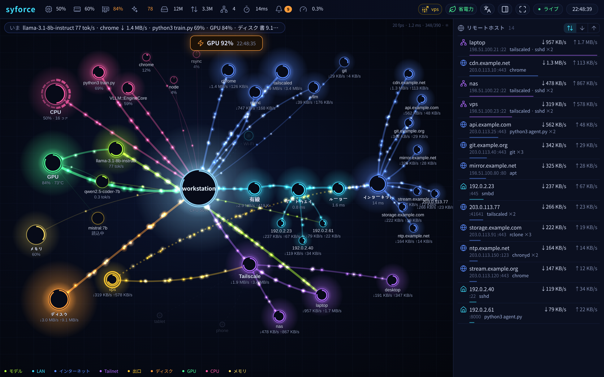
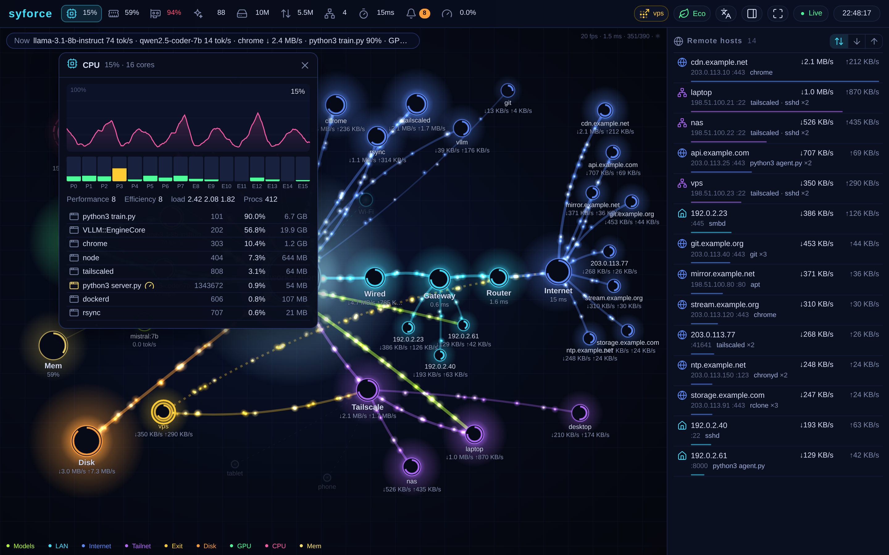
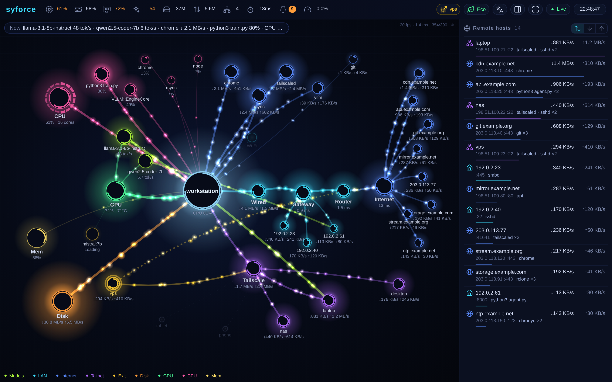

<div align="center">

<picture>
  <source media="(prefers-color-scheme: dark)" srcset="assets/brand/wordmark-tri-light.svg">
  
</picture>

[](https://syforce.ai)

Live demo: https://syforce.ai · 在线演示：https://syforce.ai

laptop / spark / dev · real data, sanitized

# syforce

**系统力导向图 · OS force-directed graph**


<!-- TODO: replace with screenshots/demo.gif -->

<!-- demo.gif placeholder: run `python server.py --demo`, record ~10 s of the page at 1440x900, save as screenshots/demo.gif -->

**syforce — a living force-directed graph of your OS: real-time topology, light-particle traffic flow, CPU/GPU/disk/models at a glance. Hand it to your AI agent to deploy on macOS / Linux / Windows.**

系统力导向图：网络流向、光粒子流量、CPU/GPU/磁盘/模型一眼看清，丢给你的 AI agent 即可部署。


</div>

<table>
<tr>
<td width="33%"><br><sub>主视图 · Main view</sub></td>
<td width="33%"><br><sub>模型弹窗 · Models popover</sub></td>
<td width="33%"><br><sub>点击聚焦 · Click-to-focus</sub></td>
</tr>
</table>

---

## 🤖 交给你的 agent · Hand it to your agent

把整个文件夹交给你的 AI 编码 agent（Claude Code、Cursor、Codex、Grok…），然后粘贴下面这段：
Give this whole folder to your AI coding agent and paste:

```text
Read AGENT_PROMPT.md in this folder and follow it exactly.
Deploy syforce on THIS machine: detect the OS, create a venv, install requirements,
adapt the collector for this OS if needed, write app/config.json for my network
(names, hide list, model ports), install it as a user service on port 9001,
then run the acceptance tests in AGENT_PROMPT.md and report the URL and results.
Rules: read-only probes only, never restart or modify model servers, containers or other services.
```

[`AGENT_PROMPT.md`](AGENT_PROMPT.md) 是完整的规格说明：设计规则、SSE 数据契约、各系统采集要点、服务安装、安全规则、部署清单和验收测试（中文在前，English follows）。

---

## 快速开始 · Quick start

```bash
cd app
python3 -m venv venv && . venv/bin/activate        # Windows: py -m venv venv && venv\Scripts\activate
pip install -r requirements.txt
python server.py --port 9001                       # then open http://localhost:9001/
```

只想看效果 / just want to see it:

```bash
python server.py --demo        # synthetic data, no collectors, safe for screenshots and recording demo.gif
```

可选配置 / optional: `cp config.example.json config.json` and edit names, hide list, ports, language (`zh`/`en`/`ja`) and fps mode (`eco`/`smooth`). URL overrides: `?lang=en`, `?mode=smooth`, `?pop=cpu`, `?focus=gpu`.

---

## 系统支持 · OS support

| OS | Status | Collectors |
|---|---|---|
| **macOS** (Apple Silicon / Intel) | ✅ ready | `proc_pid_rusage`, `netstat -anvb` per-socket bytes, IOKit/`ioreg` GPU, `sysctl` memory pressure, launchd |
| **Linux** (x86_64 / aarch64) | ✅ ready | `/proc`, `ss -tinp` per-socket bytes, NVML GPU (`nvidia-ml-py`) or `nvidia-smi`, PSI, systemd user service |
| **Windows** 11 | ✅ tested | `NtQuerySystemInformation` processes (all users, no admin), adapter-type NICs, NVML GPU (`nvidia-ml-py`) or `nvidia-smi`, Task Scheduler; no per-socket bytes or temperatures without admin |
| **Windows** 10 | 🟡 untested | same code path |

可选插件（检测到才显示）/ optional plugins, shown only when detected: **Tailscale** peers & exit node · **OpenAI-compatible model servers** (vLLM / SGLang / llama.cpp / Ollama, read-only `GET /v1/models`, `/health`, `/metrics`) · **Docker** container attribution · **topology** (default gateway + first private traceroute hops, labelled generically).

---

## 设计原则 · Design principles

- **力导向布局 · Force-directed layout** — node repulsion, edges are springs whose stiffness and rest length follow live traffic (busier link = tighter, shorter), gentle damping, soft anchors keep the machine centred and the gateway → internet chain readable. Drag any node; it springs back. The simulation sleeps when kinetic energy is low.
- **光粒子 = 真实流量 · Particles are real bytes** — direction, rate and colour of particles map to rx/tx on that link.
- **极简文字 · Terse text** — icons + fixed-width numbers in the top bar, no descriptive prose; zh / en / ja via the 文A menu.
- **点击聚焦 · Click-to-focus** — click a process, host, peer, model or link to light up everything related and dim the rest.
- **便宜 · Cheap** — backend ≈ 3 % of one core, page ≈ 15 % in 节能 (eco) mode; adaptive particle cap; nothing runs while the tab is hidden.
- **只读 · Read-only** — never controls models, containers or services.

---

## 截图 · Screenshots

| 中文 | English | 日本語 |
|---|---|---|
|  |  |  |

| CPU popover | Drag (spring back) |
|---|---|
|  |  |

All screenshots are taken with `--demo` (documentation IP ranges, generic names).

---

## 目录 · Layout

```
app/server.py                  HTTP + SSE + sampler orchestration (--demo, --port, --config)
app/syforce/collectors/        common.py (psutil) · linux.py · macos.py · windows.py
app/syforce/plugins/           tailscale.py · models.py · docker.py · topology.py
app/syforce/demo.py            synthetic data for --demo
app/static/index.html          the whole UI (canvas, physics, i18n), no build step
app/config.example.json        names, hide list, ports, language, fps mode
service/                       launchd plist · systemd user unit · Windows Task Scheduler install/uninstall
AGENT_PROMPT.md                spec + copy-paste prompt for AI agents
```

Suggested GitHub topics: `system-monitor` `dashboard` `visualization` `force-directed-graph` `tailscale` `vllm` `ai-agent`

## License

[MIT](LICENSE) — fill in the copyright holder in `LICENSE`.
